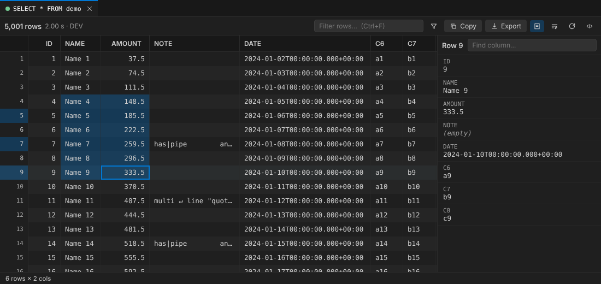

<p align="center"></p>

# Fusion SQL DEV

**An Oracle SQL Developer-style worksheet for Oracle Fusion Cloud, inside VS Code.**
Write SQL in a real editor, press <kbd>Ctrl</kbd>+<kbd>Enter</kbd>, get results in a fast grid you can actually copy from.
No VPN tunnels to the database, no BI Publisher report building - it works through the BI Publisher service every pod already has.



## Highlights

| | |
|---|---|
| **Worksheet** | Native VS Code editor: themes, multi-cursor, Find, snippets, Copilot. <kbd>Ctrl</kbd>+<kbd>Enter</kbd> runs the statement under the cursor, <kbd>F5</kbd> runs the script, CodeLens *Run* above every statement. |
| **Sign-in** | Username & password, **Single Sign-On (OAuth, MFA friendly)**, or a pasted token / session cookie. Secrets live in VS Code SecretStorage only. |
| **Zero setup on the pod** | The tiny helper BI Publisher report is installed for you (once, with consent). Already imported one by hand? It is found and reused. |
| **Results you can copy** | Click, drag, <kbd>Shift</kbd>/<kbd>Ctrl</kbd>-select cells, rows and columns. <kbd>Ctrl</kbd>+<kbd>C</kbd>, <kbd>Ctrl</kbd>+<kbd>Shift</kbd>+<kbd>C</kbd> (with headers), copy as CSV / JSON / Markdown / INSERT / `IN (...)`. Sum / Avg / Min / Max for numeric selections. |
| **Big results** | 100,000 rows are virtualised; fetch the first batch instantly, then *Fetch more* / *Fetch all*. Sort, quick filter and per-column filters (`>100`, `!x`, `empty`). |
| **Export** | Excel (real numbers & dates, frozen header, filters), CSV (UTF-8 with BOM), JSON - through native save dialogs. |
| **Schema aware** | Schema browser, table + column completion, hover docs, a built-in catalogue of common HCM / ERP / SCM tables, `DESC table`. |
| **Safe** | Read-only guard, PROD connection warning, TLS verification on, strict webview CSP, no telemetry, no runtime dependencies. |
| **`@fusion` in Copilot Chat** | `/write`, `/explain`, `/fix`, `/optimize`, `/tables` - primed with Fusion rules (date-effective filters, `_TL` joins, ...), your editor SQL, the last error and cached column lists. |

## Quick start

1. Install the `.vsix` (*Extensions → ⋯ → Install from VSIX…*) and open the **Fusion SQL** icon in the Activity Bar.
2. **Add Connection** and follow the prompts (pod URL, sign-in method, user).
   *SSO pod?* choose **Single Sign-On (OAuth)** - see [docs/SSO.md](docs/SSO.md).
3. **Fusion SQL: New SQL Worksheet**, type a query, press <kbd>Ctrl</kbd>+<kbd>Enter</kbd> (<kbd>Cmd</kbd>+<kbd>Enter</kbd> on macOS).
   The first run asks once whether it may install the helper report into your personal BI Publisher folder.

```sql
SELECT papf.person_number, ppnf.full_name
FROM   per_all_people_f papf
JOIN   per_person_names_f ppnf ON ppnf.person_id = papf.person_id AND ppnf.name_type = 'GLOBAL'
WHERE  TRUNC(SYSDATE) BETWEEN papf.effective_start_date AND papf.effective_end_date
  AND  TRUNC(SYSDATE) BETWEEN ppnf.effective_start_date AND ppnf.effective_end_date
FETCH FIRST 50 ROWS ONLY;
```

## Keyboard & mouse

| Action | Shortcut |
|---|---|
| Run statement under cursor / selection | <kbd>Ctrl</kbd>/<kbd>Cmd</kbd>+<kbd>Enter</kbd> |
| Run script (every statement) | <kbd>F5</kbd> or <kbd>Ctrl</kbd>/<kbd>Cmd</kbd>+<kbd>Shift</kbd>+<kbd>Enter</kbd> |
| Cancel running query | <kbd>Ctrl</kbd>/<kbd>Cmd</kbd>+<kbd>Shift</kbd>+<kbd>C</kbd> (while running) |
| Format SQL | Command Palette *Fusion SQL: Format SQL*, right-click menu, or <kbd>Shift</kbd>+<kbd>Alt</kbd>+<kbd>F</kbd> when Fusion SQL DEV is the SQL formatter |
| Grid: copy / copy with headers | <kbd>Ctrl</kbd>+<kbd>C</kbd> / <kbd>Ctrl</kbd>+<kbd>Shift</kbd>+<kbd>C</kbd> |
| Grid: select all / row / column | <kbd>Ctrl</kbd>+<kbd>A</kbd> / click row number / <kbd>Ctrl</kbd>+click header |
| Grid: open full value (JSON/XML pretty-printed) | double-click or <kbd>Enter</kbd> |
| Grid: filter box | <kbd>Ctrl</kbd>+<kbd>F</kbd> |

Statements end at `;`, a lone `/`, or (optionally, `fusionSqlDev.blankLineEndsStatement`) a blank line.
`:name` bind variables are prompted for and substituted as typed literals. `DESC <table>` works.

## Things BI Publisher cannot do

BI Publisher only opens cursors, so **only `SELECT` / `WITH` queries run**. DML, DDL and PL/SQL are refused with an
explanation. Row order is only guaranteed with an `ORDER BY` - add one when you page through large results.

## Settings

| Setting | Default | |
|---|---|---|
| `fusionSqlDev.fetchSize` | 1000 | Rows per request / first batch |
| `fusionSqlDev.maxRows` | 100000 | Memory cap for *Fetch all* |
| `fusionSqlDev.queryTimeoutSeconds` | 300 | Per request |
| `fusionSqlDev.runtime.install` | `ask` | `ask` / `auto` / `never` for the helper report |
| `fusionSqlDev.oauth.loopbackPort` | 53682 | Redirect `http://localhost:<port>/callback` for SSO |
| `fusionSqlDev.schema.owner` | `FUSION` | Owner shown in Schema view (`%` = all) |
| `fusionSqlDev.format.keywordCase` | `upper` | `upper` / `lower` / `preserve` |
| `fusionSqlDev.debugLogging` | off | Request metadata (never credentials or data) in the output channel |

## Troubleshooting

| Symptom | Fix |
|---|---|
| *"The server returned a web page … Single Sign-On"* | The pod is SSO-only. Edit the connection → **Single Sign-On (OAuth)**. [Guide](docs/SSO.md) |
| *"Invalid username or password"* | The extension tries a wrong password **once** (no retry storms, so no lock-outs). Fix it via *Edit Connection*. |
| *"Could not install the helper report"* | Your user cannot write to *My Folders*. Ask for the BI Author role, or have an admin install the helper once: [docs/HELPER-REPORT.md](docs/HELPER-REPORT.md). |
| *Helper installed but cannot execute* | Use **Install Helper From a Catalog File (.xdrz)** with `FusionQueryProxy.xdrz` and send the log (enable `debugLogging`). |
| *TLS certificate problem* | Corporate TLS inspection: trust the proxy root in your OS store (VS Code uses it), or tick *Allow untrusted TLS certificate* on that connection. |
| Nothing happens on <kbd>Ctrl</kbd>+<kbd>Enter</kbd> | The file's language must be **SQL** (bottom-right of the window). |

## Privacy & security

No telemetry. Requests go straight from your machine to your pod. Passwords/tokens are stored with VS Code
SecretStorage (OS keychain). Query history stores SQL text only. The results webview uses a nonce-based CSP and loads
nothing remote. See [docs/HELPER-REPORT.md](docs/HELPER-REPORT.md#security-notes) for how BI Publisher data access works.

## Development

```bash
npm install            # TypeScript + type packages only
npm run build          # compile extension + webview (no bundler)
npm test               # unit + integration tests against mock BI Publisher and IdP servers
node test/webview/webview.e2e.mjs   # browser test of the grid (Playwright)
npm run package        # -> releases/fusion-sql-dev-<version>.vsix
```

Architecture: [docs/ARCHITECTURE.md](docs/ARCHITECTURE.md). What was wrong with 1.0.26 and how it was fixed:
[docs/REVIEW-1.0.26.md](docs/REVIEW-1.0.26.md). Credits: [NOTICE.md](NOTICE.md).
